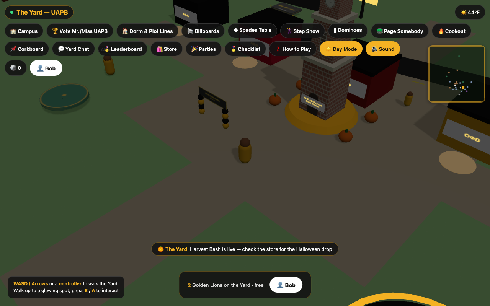
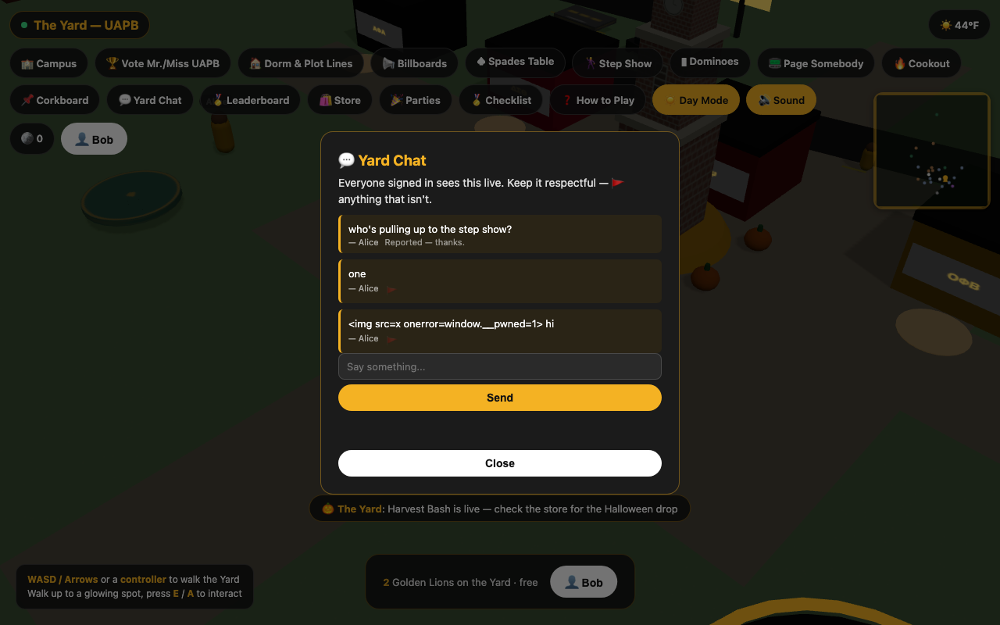
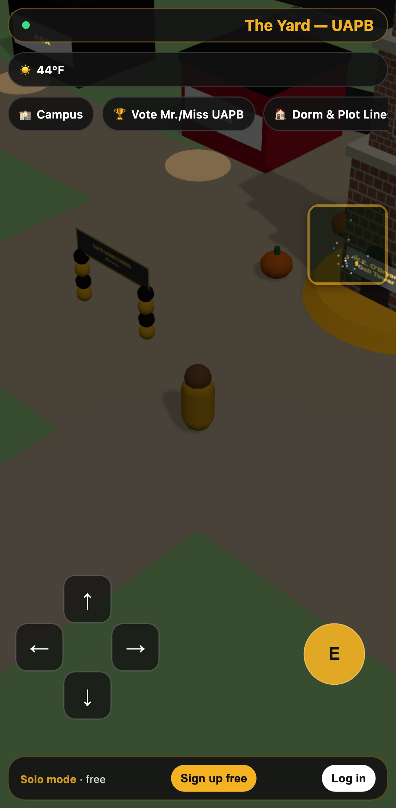

# The Yard — UAPB

**UAPB improvement pass:** see the [technical audit and phased plan](docs/UAPB-AUDIT-AND-PLAN.md) for findings, delivered changes, and release gates. UAPB is the only active campus. This remains a prototype, not a launch-ready release.

The current local build includes a focused entry screen, collapsible activity menu, analog movement controls, camera zoom/orbit/reset, an editable animated character, and basic building-footprint collision. Character appearance saves to this browser; full online appearance sync and production character art are pending. Run `npm run dev` to review it and `npm run test:mobile` for the desktop/phone experience checks.

The physical-world pass now adds OSM-derived roads/footprints, destination routes, car impact/recovery, solid environment obstacles, and enterable Student Union/library spaces. See the [reference registry](docs/references/README.md) for what is verified versus illustrative. `npm run test:world` exercises those flows; `npm run import:map` rebuilds the geographic snapshot.

[](https://github.com/Timeless-Dave/yard/actions/workflows/ci.yml)

Walk a 3D version of the real University of Arkansas at Pine Bluff campus,
play the street games and Homecoming traditions people grew up on (spades,
dominoes, Double Dutch, hopscotch, step show, the cookout, the M4 band), and
hang out with other Golden Lions.

**Play it:** https://timeless-dave.github.io/yard/ — runs in any browser,
installs to a phone's home screen, no account needed to play.

| Two players on the Yard | Live chat with reporting | On a phone |
|---|---|---|
|  |  |  |

*Screenshots are captured by the automated tests (`npm run test:e2e`,
`npm run test:mobile`), not mocked up.*

## What's in it

- **The real campus.** Building positions come from OpenStreetMap data
  ([`src/campusData.uapb.js`](src/campusData.uapb.js)). The Bell Tower,
  Student Union, Library, Caldwell Hall, and stadium are modeled from photos.
  Spots OpenStreetMap doesn't have, like the food court storefronts and the
  soccer pitch, are placed by hand and labeled as additions.
- **Nostalgia minigames.** Spades, dominoes, a pager game, cookout,
  step-show rehearsal, Double Dutch, hopscotch, a photo booth, and a boombox.
- **Homecoming life.** King and Queen voting, Divine Nine plot claims and org
  rosters, Probate Night signups, kickbacks and parties that light up on the
  map, a corkboard, Yard Chat, and Pretty Wednesday at the Lions Den every
  Wednesday (campus time).
- **Real weather.** Live Pine Bluff conditions and day/night from Open-Meteo.
- **A coin economy and store.** Earn Yard Coin from games and achievements,
  and spend it on fits and snacks. Optional Stripe coin packs.
- **Procedural everything.** Textures are drawn on canvas and every sound is
  synthesized with Web Audio, so there are no licensed image or audio assets.

Single-player works out of the box with nothing to configure. Accounts,
multiplayer, voting, chat, and the economy need a Firebase project (see
[Turning on online play](#turning-on-online-play)).

## Project status: what's verified and how

| Area | Status |
|---|---|
| Single-player game, all minigames | Runs in the deployed build; CI boots it on every push |
| Phone layout and touch controls | Tested on emulated iPhone 14 and Pixel 7: D-pad movement, interact button, modals fit the screen, no horizontal overflow |
| Multiplayer presence, chat, reporting | Tested with **two concurrent browsers** on a shared backend (Firebase emulators): players see each other, movement syncs, chat delivers live, and closing a tab removes that player for everyone |
| Security rules | 38 tests run against the real Firestore rules engine, each trying an attack a modified client could attempt. Mutation-tested: deliberately breaking 6 key rules makes the suite fail every time |
| Coin economy, store, tallies, moderation, bans, account deletion | 21 integration tests calling the real Cloud Functions in the emulator |
| Stripe | The webhook (signature checks, paid and unpaid sessions, Stripe's retry replay, coin packs, cosmetics) is tested with signed test events. **Creating a real Checkout Session has not been run**: it needs real Stripe keys |
| Live public multiplayer | **Not deployed yet.** The public site runs single-player until a Firebase project is connected. Everything above is tested against the Firebase emulators, not a live project with real users |

Run it all yourself:

```bash
npm install && (cd functions && npm install)
npm test              # unit: moderation filter, economy rules, seasonal dates
npm run test:emulator # security rules + Cloud Functions (needs Java 21)
npm run test:e2e      # two-browser multiplayer (needs Java 21)
npm run test:mobile   # emulated phones
```

CI runs all four on every push and pull request.

## Safety and moderation

The Yard represents a real school's community, so moderation is built in, not
bolted on. Full details are in [`firebase/README.md`](firebase/README.md#moderation).

- Every public text field is checked in the browser, then re-checked on the
  server by a Cloud Function. The filter blocks slurs, sexual content,
  harassment, links, phone numbers, and emails.
- 🚩 report on every message, post, nominee, and party. **3 reports from
  different players hide an item immediately**, until a moderator reviews it.
- A moderator queue (hide, restore, ban), with every action logged.
- Rate limits, ban enforcement, and hidden-content visibility live in the
  security rules, not just the UI.
- User text is always rendered as text, never HTML (tested against injected
  ``).
- Votes are private. Google sign-ins use only the first name. Players can
  delete their account and everything they've posted.
- Greek life stays public-side: rosters, plot claims, and Probate Night only.
  There's no pledge-process or ritual content, by design.

Automated moderation never catches everything. A real launch needs at least
one active human moderator.

## Turning on online play

1. Follow [`firebase/README.md`](firebase/README.md): create a free Firebase
   project, enable Anonymous, Email/Password, and Google sign-in, deploy the
   rules and Cloud Functions, and make yourself a moderator.
2. To put online play on the public GitHub Pages site, add the
   `VITE_FIREBASE_*` values from `.env.example` as repository secrets
   (**Settings → Secrets and variables → Actions**). The next push to `main`
   deploys with accounts and multiplayer turned on.

To develop against a local backend instead of a real project:

```bash
npm run dev:emulators                 # terminal 1 (needs Java 21)
VITE_USE_EMULATORS=true npm run dev   # terminal 2
```

## Install as an app

The site is an installable PWA. On a phone, use **Add to Home Screen**
(iOS) or the install prompt (Android/Chrome). An analog joystick and interact
button appear on touch devices. The service worker is network-first, so
updates always reach players, and the cache is only an offline fallback.

## Project layout

- `src/main.js`: scene setup, campus generation, avatar and camera, input,
  and modal routing.
- `src/buildings.js`: detailed models for the researched campus buildings.
- `src/campusData.*.js`: per-campus building positions (OpenStreetMap) and
  labeled additions. UAPB is the full campus. Grambling State is an early
  second campus with fewer custom building models.
- `src/minigames/`: one module per minigame or modal.
- `src/auth.js`, `src/multiplayer.js`, `src/economy.js`, `src/safety.js`,
  `src/firebase.js`: the online layer. All of it degrades gracefully to
  single-player.
- `functions/`: Cloud Functions, plus `moderation.js` and `gameRules.js`,
  which are shared with the browser so the client and server apply exactly
  the same rules.
- `firestore.rules`, `database.rules.json`, `firestore.indexes.json`:
  security rules and indexes.
- `tests/`: unit, emulator, two-browser, and phone tests.
- `scripts/`: one-off admin scripts (seed the store, grant moderator access).

## Not affiliated

The Yard is an unofficial fan project. It is not affiliated with, sponsored
by, or endorsed by the University of Arkansas at Pine Bluff, Grambling State
University, or any NPHC organization. Names and marks belong to their owners.
